<p align="center">
  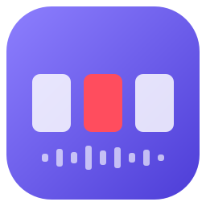
</p>

<h1 align="center">DJ Director AI</h1>

<p align="center">
  <b>Il regista multicamera automatico per i tuoi DJ set.</b><br>
  Ascolta la musica dal mixer e cambia le inquadrature in OBS Studio al posto tuo, a tempo di musica.
</p>

<p align="center">
  <a href="../../releases/latest"></a>
  
  
  <a href="../../actions/workflows/build-windows.yml"></a>
  
</p>

<p align="center">
  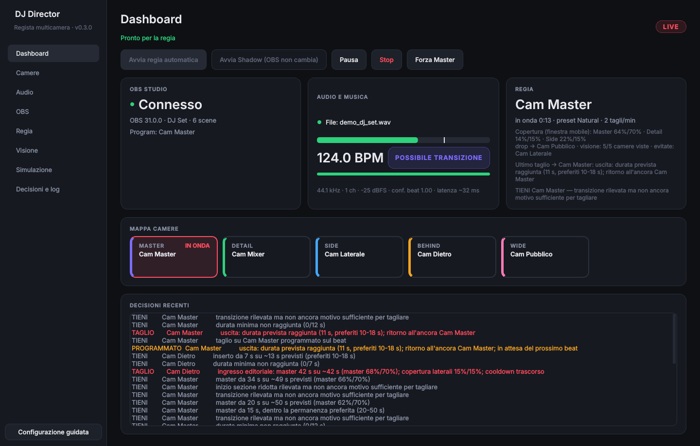
</p>

---

## Indice

- [Cosa fa](#cosa-fa)
- [Download](#download)
- [Installazione](#installazione)
- [Collegamenti e preparazione di OBS](#collegamenti-e-preparazione-di-obs)
- [Primo avvio: la configurazione guidata](#primo-avvio-la-configurazione-guidata)
- [Utilizzo](#utilizzo)
- [Behringer UCA222](#behringer-uca222)
- [Risoluzione dei problemi](#risoluzione-dei-problemi)
- [Privacy e sicurezza](#privacy-e-sicurezza)
- [Per sviluppatori](#per-sviluppatori)
- [Documentazione](#documentazione)

---

## Cosa fa

Durante il set tu pensi solo alla musica. DJ Director:

- 🎧 **ascolta** il master del mixer (interfaccia audio, mixer USB, scheda di un controller) e ne stima
  BPM, beat e andamento: groove, breakdown, build-up, drop, transizioni;
- 🎬 **decide** se e quando tagliare e su quale camera, come un regista discreto: riprese lunghe sul
  master, inserti brevi sui dettagli, tagli sul beat e sui confini di frase, mai a ogni cassa;
- 🎚️ **sente i tuoi gesti sul mixer** (novità 0.3), solo dall'audio, con qualsiasi console, MPC o
  giradischi: togli i bassi o apri un filtro → camera del mixer per 15–20 s; il basso rientra → camera
  laterale o wide sul beat. Distingue il tuo taglio dell'EQ dalla traccia che si svuota da sola;
- 👁️ **guarda le camere** (novità 0.2): evita inquadrature nere, ferme, sfocate o coperte, nota il
  movimento delle mani sul mixer e il pubblico a tempo. Sul drop apre l'inquadratura più ampia. Se vuoi,
  un modello AI **locale** (offline, con Ollama) o cloud giudica quale camera è più interessante;
- 🎛️ **comanda OBS** cambiando la scena *Program* tramite obs-websocket (incluso in OBS 28+), senza
  toccare registrazione, streaming, sorgenti o filtri;
- ✋ **rispetta te**: se cambi scena a mano in OBS, il programma se ne accorge e non ti contraddice;
- 🧪 offre la modalità **Shadow** (decide e mostra tutto senza toccare OBS) e una **Simulazione** su set
  registrati;
- 🇮🇹 ha un'interfaccia **in italiano** (o inglese) e funziona **offline**; il cloud è solo un'opzione
  che scegli tu.

> Un bravo regista sa anche quando *non* cambiare camera. Ogni decisione di DJ Director, compresa quella
> di restare sull'inquadratura attuale, ha un motivo che puoi leggere.

---

## Download

➡️ **[Scarica l'ultima versione dalla pagina Releases](../../releases/latest)**

| File | Contenuto |
|---|---|
| `DJDirectorAI-<versione>-win64.zip` | Il programma per Windows 10/11 a 64 bit (versione portable, guida inclusa) |
| `Guida_DJ_Director_AI.pdf` | La guida completa all'utilizzo, da stampare o leggere sul telefono |

Requisiti: Windows 10 o 11 a 64 bit, OBS Studio 28 o successivo, un ingresso audio con il master del mixer.
Non serve Python e il programma usa pochi punti percentuali di un core della CPU. La scheda video serve
solo per l'occhio lento con un modello AI locale (consigliata NVIDIA da 8 GB, per esempio RTX 4060).

---

## Installazione

1. **Scarica** `DJDirectorAI-<versione>-win64.zip` dalla pagina [Releases](../../releases/latest).
2. **Estrai** lo zip (clic destro → *Estrai tutto…*) in una cartella a tua scelta, per esempio
   `C:\Programmi DJ\DJDirectorAI`. Non c'è un installer: è una versione *portable*.
3. **Avvia** `DJDirectorAI.exe`.
4. Se Windows mostra **"Windows ha protetto il PC"** (SmartScreen, l'eseguibile non è firmato digitalmente),
   clicca **Ulteriori informazioni → Esegui comunque**. Succede solo la prima volta.
5. *(Facoltativo)* Crea un collegamento sul desktop: clic destro su `DJDirectorAI.exe` → *Invia a* →
   *Desktop (crea collegamento)*.

Le impostazioni vengono salvate in `%APPDATA%\DJDirectorAI` e i log in `%LOCALAPPDATA%\DJDirectorAI\logs`,
non nella cartella del programma. Per disinstallare basta eliminare la cartella (ed eventualmente quelle
due).

---

## Collegamenti e preparazione di OBS

**Audio**: porta il *mix* al PC con un ingresso di linea. Esempio con la Behringer UCA222:

```
 Mixer DJ ── uscita REC / BOOTH ──(RCA)──► Behringer UCA222 ──(USB)──► PC
```

**Video**: le camere entrano in OBS come al solito. In OBS crea **una scena per ogni inquadratura**
(`Cam Master`, `Cam Mixer`, `Cam Laterale`, `Cam Pubblico`…).

**OBS WebSocket** (una volta sola): in OBS apri *Strumenti › Impostazioni server WebSocket*, spunta
**Abilita server WebSocket**, lascia la porta **4455** e copia la password da *Mostra informazioni di
connessione*.

---

## Primo avvio: la configurazione guidata

Al primo avvio una procedura in sei passi ti accompagna in tutto. La puoi riaprire in qualsiasi momento dal
pulsante **Configurazione guidata**.

| 1 · Collega OBS | 2 · Scegli le camere |
|---|---|
| 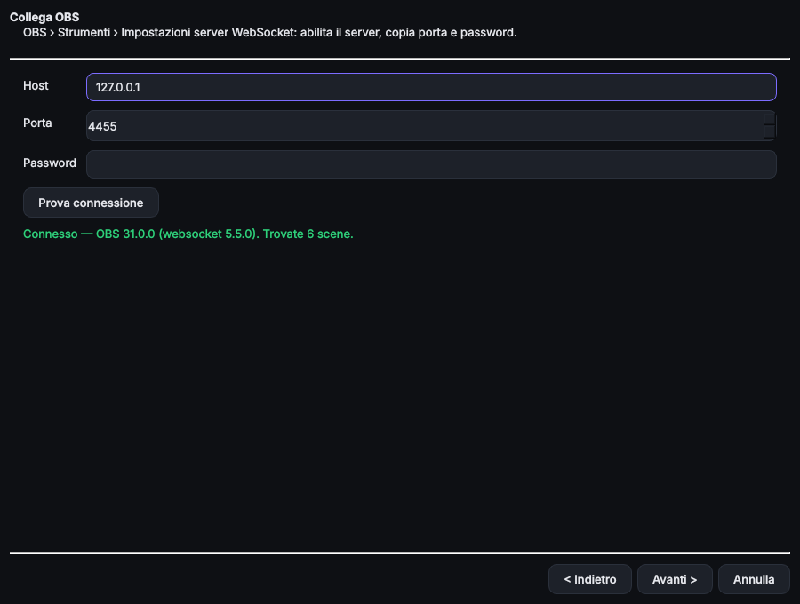 | 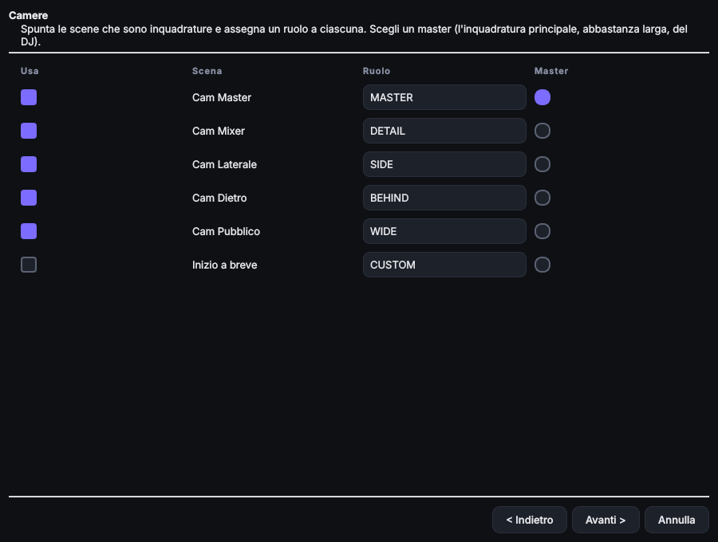 |
| Inserisci la password di OBS e premi **Prova connessione**. | Spunta le scene che sono inquadrature, assegna un **ruolo** e scegli il **Master**. |

| 3 · Ingresso audio | 4 · Stile di regia |
|---|---|
| 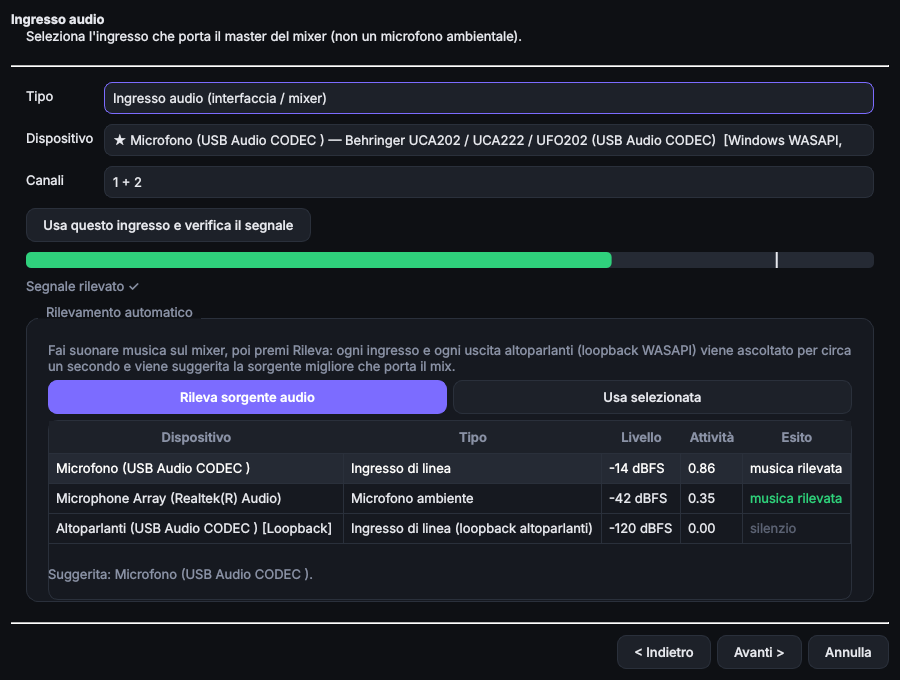 | 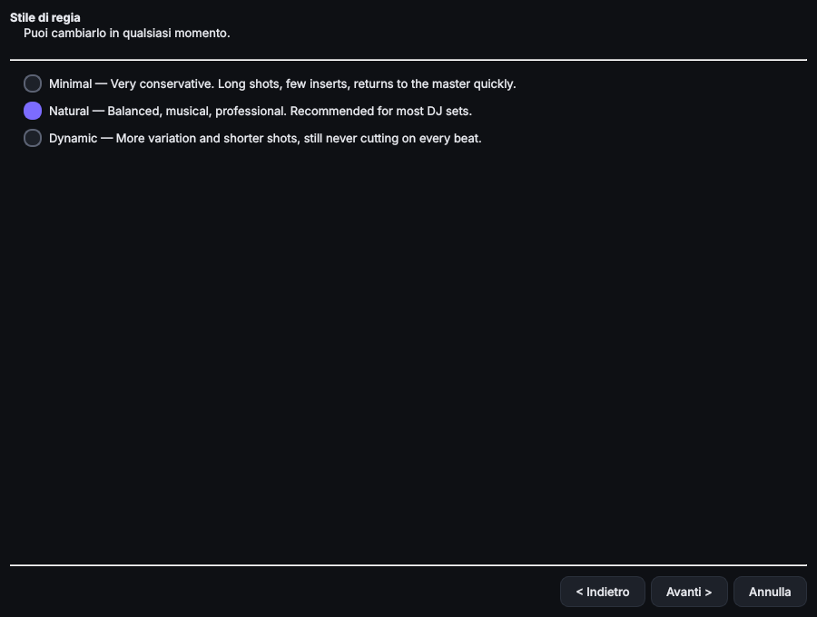 |
| Fai suonare musica e premi **Rileva sorgente audio**: il programma trova da solo l'ingresso con il mix. | Scegli **Natural** (consigliato). Per la prima prova lascia attiva la modalità **Shadow**. |

**I ruoli delle camere**

| Ruolo | Inquadratura | Uso da parte del regista |
|---|---|---|
| **MASTER** | Principale, frontale sul DJ | L'"ancora": ~70% del tempo, riprese di solito da 20–50 s |
| **DETAIL** | Mani, mixer, piatti | Inserti brevi (6–10 s, mai oltre 14 s), soprattutto durante i mix |
| **SIDE** | Laterale | Inserti medi (10–18 s, mai oltre 22 s) |
| **BEHIND** | Da dietro il DJ, verso la sala | Come SIDE, preferita sulle ripartenze |
| **WIDE** | Campo largo, pubblico | Come SIDE, preferita sui drop |
| **OVERHEAD** | Dall'alto | Come DETAIL, durante le transizioni |
| **CUSTOM** | Altro | Uso neutro (classe SIDE) |

Il regista mantiene un **budget di copertura** morbido su una finestra di 5 minuti: Master 70%,
Detail 15%, Side/Behind 15%. È una tendenza, non una quota da inseguire secondo per secondo.

---

## Utilizzo

### Una serata in 5 passi

1. Accendi mixer e interfaccia audio, apri **OBS** e controlla che le camere si vedano.
2. Apri **DJ Director**: OBS risulta *Connesso* da solo.
3. Fai partire un brano: in alto compare **"Pronto per la regia"**.
4. In OBS avvia **registrazione o streaming** come sempre.
5. In DJ Director premi **Avvia regia automatica**… e suona.

Per intervenire durante il set: clicca una scena in OBS (il cambio manuale viene rispettato), premi
**Forza Master** o **Pausa**. A fine set premi **Stop**: OBS continua a registrare finché non lo fermi tu.

### Dashboard


- **In alto**: se il programma è pronto, i pulsanti principali e lo stato (`LIVE`, `SHADOW`, `PAUSED`…).
- **OBS Studio**: connessione e scena in onda.
- **Audio e musica**: livello, **BPM**, affidabilità del beat e stato musicale (*Groove stabile*, *Ritmo
  ridotto*, *Ripartenza forte*…).
- **Regia**: camera in onda, da quanto tempo, ultimo taglio e il suo motivo.
- **Mappa camere**: in rosso la camera **IN ONDA**, in giallo la **PROSSIMA** (taglio programmato sul beat).
- **Decisioni recenti**: ogni decisione con il motivo reale (*TIENI* è una decisione normale).

### Camere

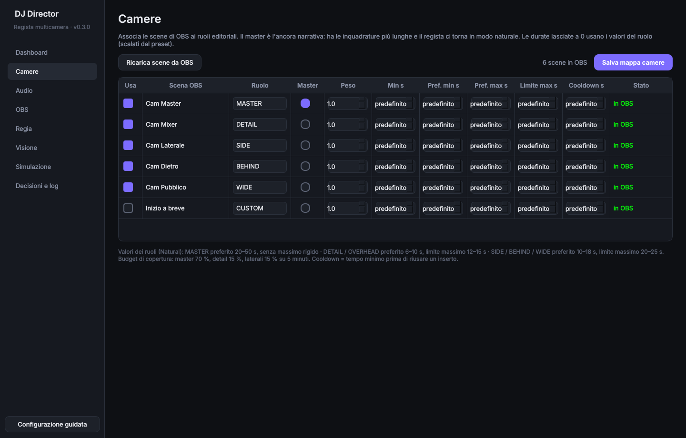

Associa ogni scena di OBS a un ruolo e scegli il Master. Durate, peso e cooldown sono facoltativi
("predefinito" va bene quasi sempre). Se rinomini una scena in OBS, il programma si aggiorna da solo.

### Audio e rilevamento automatico della sorgente

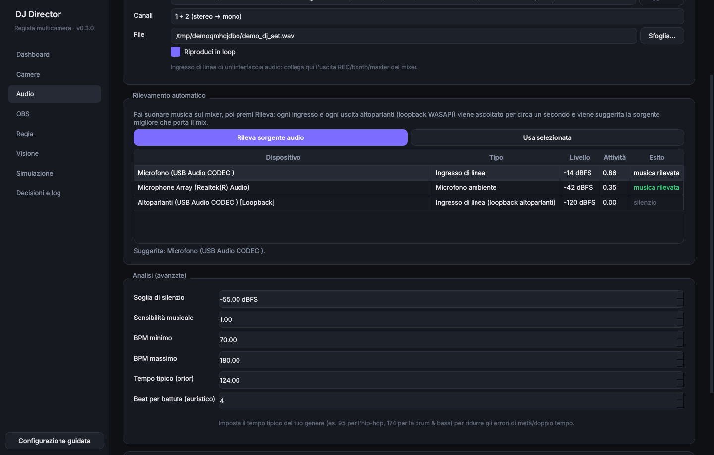

**Rileva sorgente audio** ascolta per un secondo ogni ingresso e ogni uscita (loopback) e suggerisce quella
che porta il mix. Gli ingressi di linea vengono preferiti ai microfoni ambientali. Nella stessa pagina trovi
il livello in tempo reale, il clipping e le impostazioni di analisi (per esempio il *Tempo tipico* del tuo
genere).

### OBS

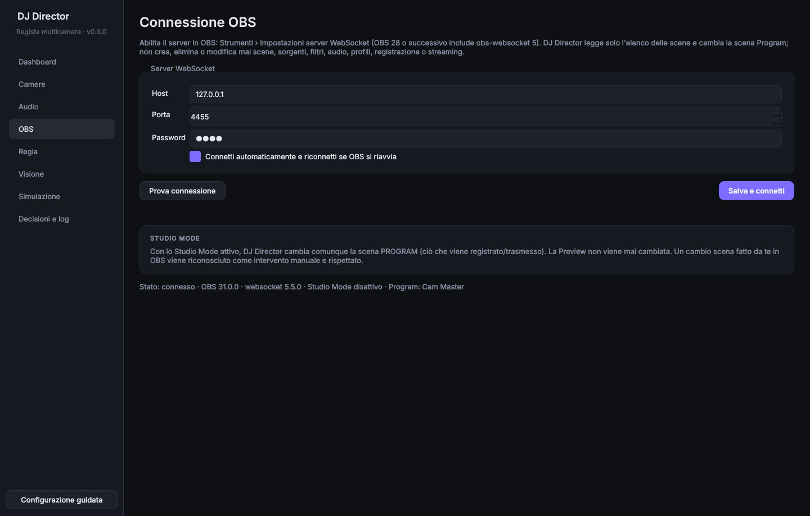

Host, porta e password (salvata **cifrata** con la protezione di Windows). Con lo Studio Mode attivo,
DJ Director cambia comunque la scena **Program** e non tocca mai la Preview.

### Regia: stile, comportamento e calibrazione

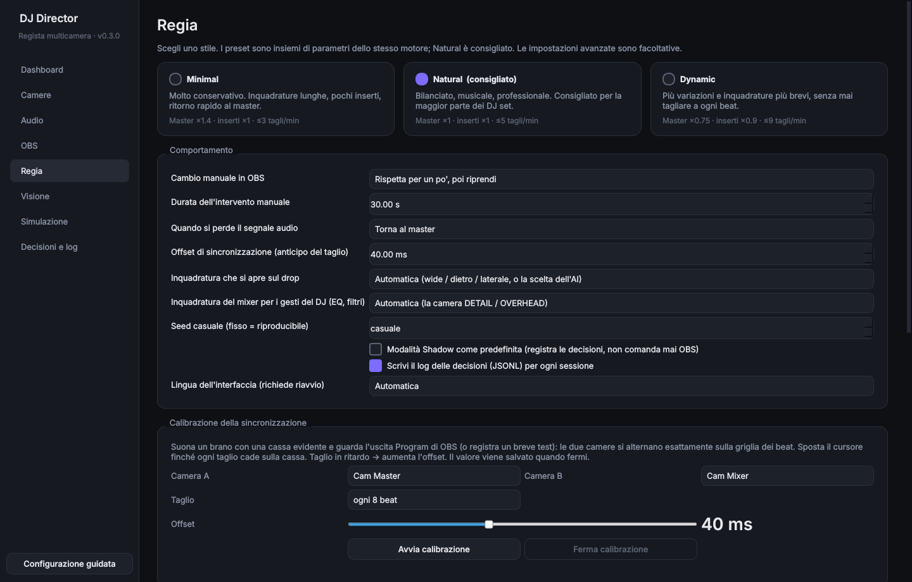

Tre stili, cioè tre impostazioni dello stesso motore:

| Stile | Carattere | Tagli al minuto (indicativi) |
|---|---|---|
| **Minimal** | Molto sobrio, riprese lunghe, pochi inserti | ~1 |
| **Natural** | Bilanciato e musicale (consigliato) | ~2 |
| **Dynamic** | Più movimento, mai frenetico | ~5 |

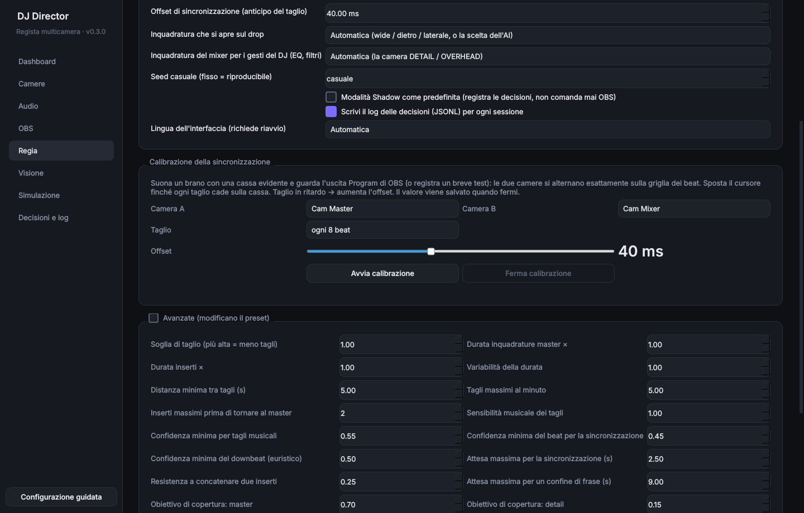

**Calibrazione della sincronizzazione** (consigliata una volta): due camere si alternano esattamente sul
beat. Sposta il cursore finché il taglio cade sulla cassa (taglio in ritardo → più anticipo), poi premi
**Ferma calibrazione** per salvare il valore.

In **Comportamento** scegli anche l'**inquadratura che si apre sul drop** e l'**inquadratura del mixer per i
gesti del DJ**: una qualsiasi delle tue scene, automatica oppure spenta.

### Visione: il regista guarda le camere

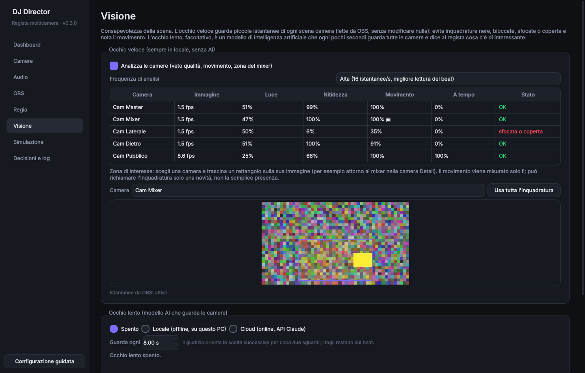

- **Occhio veloce** (sempre locale, senza AI): legge piccole istantanee delle scene da OBS, in sola
  lettura. Esclude le camere nere, sovraesposte, ferme o sfocate / coperte e misura il movimento,
  anche solo nella **zona di interesse** che disegni (per esempio il mixer). Conta il gesto nuovo, non le
  mani ferme.
- **Occhio lento** (facoltativo): un modello AI guarda tutte le camere ogni pochi secondi e dice quali
  sono interessanti, quali da evitare e quale mostrerebbe meglio il drop. Orienta le scelte; i tagli
  restano sul beat.

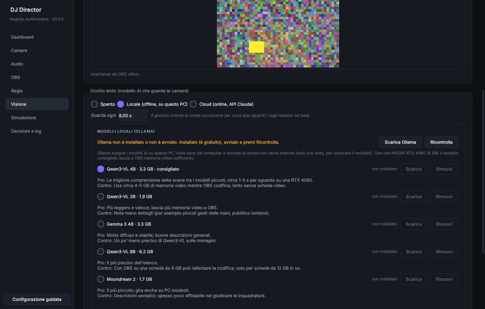

| Occhio lento | Pro | Contro |
|---|---|---|
| **Locale** (Ollama, consigliato Qwen3-VL 4B) | Gratis, offline, nulla esce dal PC | Serve una scheda video; il modello va scaricato una volta (3,3 GB) |
| **Cloud** (API Claude) | Il giudizio migliore, nessun carico sul PC | Internet, chiave API, costo per sguardo; le istantanee lasciano il PC |

La pagina include anche una **sonda MIDI**: dice se il tuo controller invia messaggi al PC. È un extra: i
gesti sul mixer il regista li sente già dall'audio.

### Simulazione

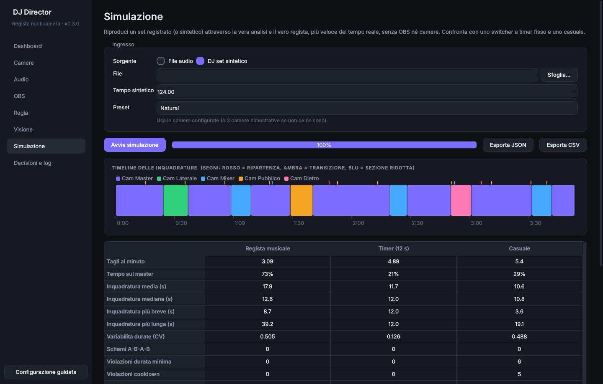

Fai passare un set registrato (WAV/FLAC) attraverso il vero regista, molto più veloce del tempo reale e
senza OBS né camere. La timeline mostra le inquadrature e gli eventi musicali, e la tabella confronta il
regista con uno switcher a timer e con uno casuale. È il modo migliore per scegliere lo stile adatto alla
tua musica.

### Decisioni e log

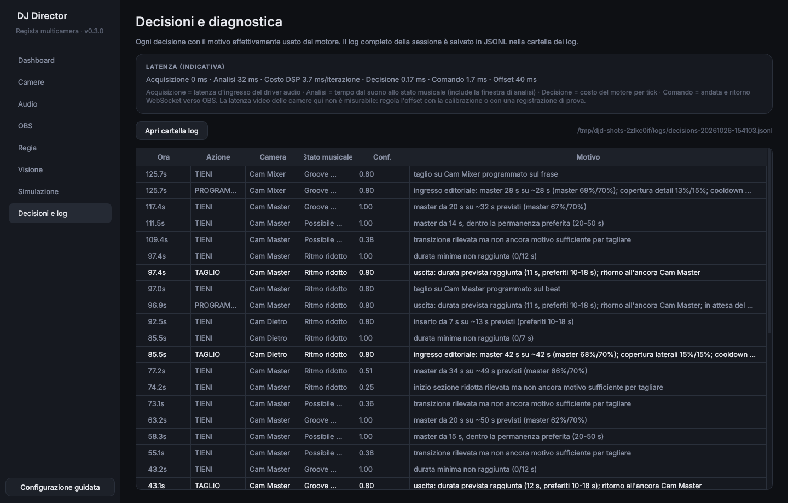

Tutte le decisioni con il loro motivo, le latenze misurate e l'accesso alla cartella dei log (un file JSONL
per ogni sessione).

---

## Behringer UCA222

Windows mostra la UCA222 come due dispositivi:

| Dispositivo Windows | Che cos'è | Come usarlo |
|---|---|---|
| **Microfono (USB Audio CODEC)** | L'**ingresso RCA** (non un microfono vero) | *Ingresso audio* → è la sorgente consigliata, indicata con ★ |
| **Altoparlanti (USB Audio CODEC)** | L'uscita RCA/cuffie | *Loopback WASAPI* → solo se il software DJ suona dal PC attraverso la UCA222 |

- Canali: **1 + 2**.
- Se il livello resta a **zero esatto**, Windows sta bloccando il "microfono": *Impostazioni › Privacy e
  sicurezza › Microfono › Consenti alle app desktop di accedere al microfono*. Il programma lo rileva e lo
  segnala.
- La UCA222 non ha un controllo di guadagno: regola il livello dall'uscita REC del mixer, evitando il
  clipping (il meter diventa rosso).
- OBS può usare lo stesso ingresso nello stesso momento.

Vanno bene anche altre interfacce audio, la scheda audio interna di mixer e controller DJ o un mixer USB.

---

## Risoluzione dei problemi

| Problema | Soluzione |
|---|---|
| OBS "Disconnesso" | OBS è aperto? Il server WebSocket è abilitato? Porta 4455? |
| OBS "Password errata" | Ricopia la password nella pagina **OBS** e premi **Salva e connetti** |
| Nessun segnale audio | Controlla il cavo dall'uscita REC del mixer all'interfaccia e usa **Rileva sorgente audio** |
| Livello a zero esatto | Privacy microfono di Windows (vedi la sezione UCA222) |
| BPM doppi o dimezzati | *Audio › Analisi › Tempo tipico*: impostalo vicino al tuo genere |
| Taglia troppo / troppo poco | Prova lo stile **Minimal** o **Dynamic** |
| Resta su `ARMED` | Leggi il messaggio: di solito OBS non è connesso o manca una scena |
| Visione: "nessuna immagine" | In OBS togli *Disattiva quando non mostrata* dalla sorgente camera |
| Occhio lento in errore | Avvia Ollama e premi **Ricontrolla**, poi scarica il modello scelto |

Altri casi nella [guida completa](docs/GUIDA_UTENTE.md#12-risoluzione-dei-problemi).

---

## Privacy e sicurezza

- Nessuna telemetria, nessun account: **l'audio non lascia mai il PC**, e nemmeno le immagini, a meno
  che tu non attivi l'occhio lento **cloud**. In quel caso le istantanee delle camere vengono inviate
  all'API Claude.
- Il programma comunica con OBS sull'indirizzo configurato (di default `127.0.0.1`), con Ollama sul PC
  (`127.0.0.1:11434`) se usi il modello locale e con l'API Claude solo se scegli il cloud.
- In OBS usa solo sei comandi: lettura di versione, elenco scene, collezione di scene, stato dello
  Studio Mode e istantanea di una scena (sola lettura), più il cambio della scena Program.
  **Non** crea, elimina o modifica scene, sorgenti, filtri o audio e **non** avvia né ferma registrazione
  o streaming. Lo garantisce un elenco di comandi consentiti nel codice, verificato dai test.
- La password di OBS e la chiave API Claude sono cifrate con Windows DPAPI e non compaiono mai in
  configurazione o nei log.

---

## Per sviluppatori

```bash
git clone https://github.com/Nicodesy06/Livecuts-dj-.git && cd Livecuts-dj-
python -m venv .venv && . .venv/bin/activate        # Windows: .venv\Scripts\activate
pip install -r requirements-lock.txt && pip install -e ".[dev]"
QT_QPA_PLATFORM=offscreen pytest                     # 190+ test: unit, integrazione, GUI, qualità
python -m dj_director                                # avvia l'interfaccia
```

Strumenti da riga di comando (anche come `dj-director-cli.exe` nella release):

```bash
dj-director simulate set.wav --preset natural --json out.json   # replay offline di un set
dj-director devices                                             # elenca gli ingressi audio
dj-director obs-test --password XXX                             # prova la connessione a OBS
dj-director fake-obs                                            # OBS simulato per i test
dj-director selftest                                            # verifica di un'installazione
```

**Build Windows**: `powershell -ExecutionPolicy Bypass -File scripts\build_windows.ps1` (test, PyInstaller,
self-test degli eseguibili, guida PDF, zip). La CI (`.github/workflows/build-windows.yml`) fa lo stesso su
ogni push. Per pubblicare una release: *Actions › test-and-build-windows › Run workflow* con
`release_tag` (es. `v0.3.0`).

**Struttura**

```
src/dj_director/
├── audio/       acquisizione (PortAudio, loopback WASAPI, file), riconoscimento e rilevamento sorgenti
├── music/       feature spettrali, beat tracker causale, stati musicali
├── director/    motore decisionale, camere, calibrazione
├── obs/         client obs-websocket 5 con allow-list, controller, OBS simulato
├── simulation/  replay deterministico, set sintetico, metriche editoriali
├── visual/      visione: istantanee da OBS, occhio veloce, occhio lento (Ollama / API Claude)
├── sensors/     sonda MIDI
├── ui/          interfaccia PySide6 e traduzioni
├── config/      configurazione validata, preset, password cifrata
└── core/        contratti tipizzati, application controller
```

Gli screenshot di questa pagina sono generati con `scripts/make_screenshots.py`: il programma reale,
collegato all'OBS simulato incluso e a un set audio sintetico. L'elenco dei dispositivi audio e la tabella
del rilevamento mostrano un esempio con la UCA222, perché la macchina che genera le immagini non ha una
scheda audio. Le immagini delle camere nella pagina Visione sono quelle sintetiche dell'OBS simulato.

---

## Documentazione

| Documento | Contenuto |
|---|---|
| [Guida all'utilizzo](docs/GUIDA_UTENTE.md) | Manuale completo per l'utente (anche in PDF nella release) |
| [Come decide il regista](docs/DIRECTOR.md) | Ingresso e uscita, budget di copertura, gesti del DJ dall'audio, visione (occhio veloce e lento), drop, timing, preset |
| [Architettura](docs/ARCHITECTURE.md) | Moduli, thread, flussi di dati |
| [Audit tecnico](docs/TECHNICAL_AUDIT.md) | Scelte tecnologiche, librerie e rischi |
| [Test e risultati](docs/TESTING.md) | Test automatici, misure, checklist dei test manuali |
| [Report v0.1](docs/REPORT_v0.1.md) | Stato del progetto, limiti noti, prossimi passi |
| [Changelog](CHANGELOG.md) | Novità di ogni versione |
| [Licenze di terze parti](THIRD_PARTY_LICENSES.md) | Componenti inclusi e loro licenze |

---

<p align="center"><sub>© 2026 Nicola Mantovani · Tutti i diritti riservati · vedi <a href="LICENSE">LICENSE</a></sub></p>
