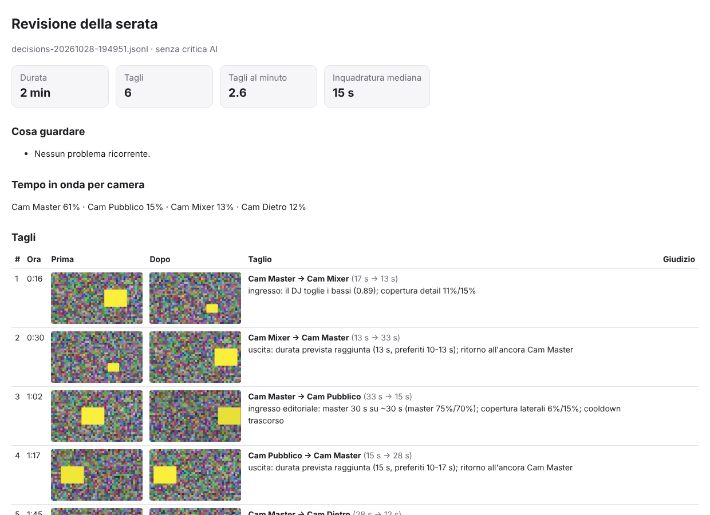

# DJ Director AI — Guida all'utilizzo

Versione 0.5.0 · Windows 10/11 (64 bit)

DJ Director AI è un regista automatico per i tuoi DJ set. Ascolta la musica che esce dal mixer, ne capisce
l'andamento (tempo, beat, breakdown, drop) e cambia da solo le inquadrature in OBS Studio, come farebbe
un regista discreto. Tu suoni, lui fa la regia.

Il programma **non registra e non trasmette**: lo fa OBS, come sempre. DJ Director si limita a scegliere
quale scena di OBS mandare in onda. Se lo chiudi o si blocca, OBS continua a registrare normalmente.

---

## 1. Cosa ti serve

| Cosa | Note |
|---|---|
| PC Windows 10 o 11 a 64 bit | Basta una CPU recente: il programma usa pochi punti percentuali di un core. La scheda video serve solo se attivi l'occhio lento con un modello locale (capitolo 9) |
| OBS Studio 28 o successivo | Contiene già il server WebSocket che DJ Director usa per comandarlo |
| Da 2 a 8 camere già configurate in OBS | Una **scena** di OBS per ogni inquadratura |
| Un ingresso audio con il **master del mixer** | Per esempio una Behringer UCA222 collegata all'uscita REC del mixer |

Non serve Python, non serve un account, non serve Internet. Nessun dato audio o video lascia il PC,
a meno che tu non scelga esplicitamente l'occhio lento **cloud** (capitolo 9).

---

## 2. Installazione

1. Scarica **`DJDirectorAI-0.3.0-win64.zip`** dalla pagina *Releases* del progetto su GitHub.
2. Fai clic destro sullo zip → **Estrai tutto…** in una cartella a tua scelta, per esempio
   `C:\Programmi DJ\DJDirectorAI`. È una versione *portable*: non c'è un'installazione vera e propria.
3. Apri la cartella ed esegui **`DJDirectorAI.exe`**.

> **Avviso di Windows SmartScreen.** L'eseguibile non è firmato digitalmente, quindi al primo avvio Windows
> può mostrare "Windows ha protetto il PC". Fai clic su **Ulteriori informazioni** → **Esegui comunque**.
> Succede solo la prima volta.

Per comodità puoi creare un collegamento sul desktop: clic destro su `DJDirectorAI.exe` → *Invia a* →
*Desktop (crea collegamento)*.

**Disinstallazione:** elimina la cartella del programma. Se vuoi cancellare anche impostazioni e log,
elimina `%APPDATA%\DJDirectorAI` e `%LOCALAPPDATA%\DJDirectorAI` (incolla questi percorsi nella barra
degli indirizzi di Esplora file).

---

## 3. Collegamenti

### Audio (esempio con Behringer UCA222)

```
 Mixer DJ ── uscita REC / BOOTH ──(cavo RCA)──► UCA222 ingressi RCA ──(USB)──► PC
```

- Usa un'uscita del mixer che **non dipenda dal volume del master** del locale, se possibile (REC è ideale).
- Windows mostra la UCA222 come due dispositivi:
  - **Microfono (USB Audio CODEC)**: è l'**ingresso RCA**, non un microfono vero. È questo che devi usare.
  - **Altoparlanti (USB Audio CODEC)**: è l'uscita. Serve solo se il software DJ suona dal PC attraverso
    la UCA222; in quel caso DJ Director può "ascoltarla" in *loopback*.
- La UCA222 non ha una manopola di guadagno: regola il livello dall'uscita REC del mixer, oppure in
  Windows (*Impostazioni › Sistema › Audio › Microfono (USB Audio CODEC) › Volume di input*).

Vanno bene anche altre interfacce audio, la scheda audio interna di un mixer o di un controller DJ, o un
mixer USB: l'importante è che arrivi il **mix pulito**. Un microfono ambientale funziona solo in emergenza,
perché sente le casse e il pubblico.

### Video

Le camere si collegano a OBS come al solito. In OBS crea **una scena per ogni camera**, con nomi chiari
come `Cam Master`, `Cam Mixer`, `Cam Laterale`, `Cam Pubblico`. DJ Director legge i nomi delle scene e
li usa così come sono.

---

## 4. Preparare OBS (una volta sola)

1. Apri OBS → menu **Strumenti › Impostazioni server WebSocket**.
2. Spunta **Abilita server WebSocket**.
3. Lascia la porta **4455**. Clicca **Mostra informazioni di connessione** e copia la **password**.
4. Clicca **OK**.

DJ Director **non crea, non elimina e non modifica** scene, sorgenti, filtri, audio o profili, e **non
avvia né ferma** registrazione o streaming. Fa una sola cosa: cambia la scena **Program**.

---

## 5. Primo avvio: la configurazione guidata

Al primo avvio si apre la **Configurazione guidata**. Puoi riaprirla in qualsiasi momento dal pulsante in
basso a sinistra.


1. **Benvenuto**: un riepilogo di cosa farai.
2. **Collega OBS**: con OBS aperto, inserisci host `127.0.0.1`, porta `4455` e la password copiata, poi
   premi **Prova connessione**. Deve comparire "Connesso" con il numero di scene trovate.
3. **Camere**: spunta le scene che sono inquadrature (non "Inizio a breve", "Pausa" e simili), assegna a
   ciascuna un **ruolo** e scegli il **Master**.
4. **Ingresso audio**: fai suonare musica sul mixer e premi **Rileva sorgente audio**. Il programma
   ascolta ogni ingresso e ogni uscita per un secondo e seleziona quella con il mix. Poi premi **Usa
   selezionata** e controlla che l'indicatore di livello si muova.


5. **Stile di regia**: scegli **Natural** (consigliato).
6. **Pronto**: lascia spuntata **"Usa la modalità Shadow come predefinita"** per la prima prova.

### I ruoli delle camere

| Ruolo | Che inquadratura è | Come la usa il regista |
|---|---|---|
| **MASTER** | L'inquadratura principale del DJ, frontale e abbastanza larga | È l'"ancora": la più usata (~70% del tempo), con riprese di solito da 30–50 s, senza un massimo rigido |
| **DETAIL** | Mani, mixer, piatti, controller | Inserti brevi: 6–10 s, mai oltre 14 s (regolabile 12–15). Soprattutto durante i mix |
| **OVERHEAD** | Dall'alto sulla consolle | Inserti 7–11 s, mai oltre 15 s, durante le transizioni |
| **SIDE** | Laterale sul DJ | Inserti medi: 10–17 s, mai oltre 23 s (regolabile 20–25) |
| **BEHIND** | Da dietro il DJ, verso la sala | Come SIDE, preferita sulle ripartenze |
| **WIDE** | Campo largo, sala | Come SIDE, preferita sui drop |
| **CROWD** | Il pubblico | Inserti 6–12 s, la prima scelta sui drop |
| **CUSTOM** | Qualsiasi altra | Uso neutro (conta come SIDE) |

Il regista distribuisce il tempo con un **budget di copertura** su una finestra mobile di 5 minuti:
**Master 70%** e inserti 30%: **Detail 15%** (DETAIL + OVERHEAD), **Side 15%** (SIDE, BEHIND, WIDE, CROWD,
CUSTOM). È una quota
*morbida*: orienta le scelte ma non provoca tagli per inseguire i numeri. La copertura attuale si vede in
Dashboard.

Puoi avere più camere con lo stesso ruolo. Serve **un solo Master**.

---

## 6. La Dashboard


È la schermata principale. In alto, sotto il titolo, trovi lo stato: **"Pronto per la regia"** in verde
oppure **"Non pronto: …"** in giallo, con l'elenco di cosa manca.

**Pulsanti**

| Pulsante | Cosa fa |
|---|---|
| **Avvia regia automatica** | Va in onda: il programma decide e cambia le scene in OBS |
| **Avvia Shadow (OBS non cambia)** | Prova a vuoto: decide e mostra tutto, ma **non tocca OBS** |
| **Pausa / Riprendi** | Sospende la regia, che resta sull'inquadratura attuale |
| **Stop** | Ferma la regia. OBS continua a registrare |
| **Forza Master** | Torna subito sulla camera Master |

**Diagnostica della regia** (riquadro sotto la mappa delle camere), pensata per un'occhiata durante il set:

| Voce | Cosa dice |
|---|---|
| **In Program** | la scena davvero in onda in OBS, con il tipo di inquadratura |
| **Sorgente** | *sana*, *non verificata* (nessuna analisi o dati vecchi) o *non valida* (con il motivo) |
| **Ultimo taglio: perché** | il motivo dell'ultimo cambio e per quanto è previsto che duri |
| **Prossimo taglio** | il taglio già programmato, tra quanti secondi e perché |
| **Tempo reale in onda (5 min)** | la ripartizione del tempo **confermato** in onda per camera |
| **Rifiutati / annullati** | l'ultimo taglio che non è avvenuto e perché (per esempio "sostituito da un taglio più recente" o un errore di OBS) |

**Stato del regista** (etichetta colorata in alto a destra)

| Stato | Significato |
|---|---|
| OFF | Fermo |
| ARMED | Avviato ma in attesa (per esempio OBS non connesso) |
| LIVE | In onda: sta comandando OBS |
| LIVE · MANUAL | Hai cambiato scena a mano: il programma ti sta rispettando |
| SHADOW | Prova a vuoto |
| PAUSED | In pausa |
| CALIBRATING | Calibrazione in corso |
| ERROR | Problema di configurazione: leggi il messaggio |

**Riquadri**

- **OBS Studio**: connessione, collezione di scene e scena in onda (Program).
- **Audio e musica**: dispositivo, livello (verde = ok, giallo = alto, rosso = clipping), **BPM** stimati,
  barra di affidabilità del beat e **stato musicale**: *Groove stabile*, *Attività in aumento/calo*,
  *Ritmo ridotto* (breakdown), *Possibile transizione* (stai mixando), *Ripartenza forte* (drop).
- **Regia**: camera in onda, da quanto tempo, ultimo taglio e il suo **motivo**.
- **Mappa camere**: la camera **IN ONDA** ha il bordo rosso, la **PROSSIMA** (taglio programmato sul
  beat) il bordo giallo.
- **Decisioni recenti**: ogni decisione con il motivo reale. *TIENI* (resto sull'inquadratura) è una
  decisione normale: un buon regista sa anche quando non tagliare.

---

## 7. Una serata tipo

**Prima del set (5 minuti)**

1. Accendi mixer e UCA222, apri **OBS** e controlla che le camere si vedano.
2. Apri **DJ Director**: OBS deve risultare *Connesso* (si collega da solo).
3. Fai partire un brano: il livello si muove, compaiono i BPM e la scritta in alto diventa
   **"Pronto per la regia"**.
4. In OBS avvia **la registrazione o lo streaming** come fai di solito.
5. In DJ Director premi **Avvia regia automatica**.

**Durante il set**

Suoni e basta. Non serve toccare il PC. Se vuoi intervenire:

- **Cambio manuale**: clicca una scena in OBS. DJ Director lo nota e ti lascia fare per 30 secondi
  (modificabile), poi riprende da solo.
- **Scena di servizio** ("Pausa", "Inizio a breve"…): se la metti tu in onda, la regia si sospende finché
  non premi **Riprendi**. Non verrai mai "tirato fuori" da quella scena.
- **Forza Master**: torna subito sull'inquadratura principale.

**Fine del set**

Premi **Stop** in DJ Director, poi ferma la registrazione in OBS.

---

## 8. Le altre pagine

### Camere


L'elenco delle scene di OBS. Per ciascuna: **Usa**, **Scena OBS**, **Ruolo**, **Master**, **Peso** (più alto
= scelta più spesso). Seguono, facoltative, le durate:
- **Min**: durata minima;
- **Pref. min** e **Pref. max**: la finestra preferita, dentro cui il regista sceglie la lunghezza;
- **Hard cap**: il tetto assoluto, mai superato;
- **Cooldown**: il tempo minimo prima di riusare un inserto.

Lascia "predefinito" per usare i valori del ruolo. Premi **Salva mappa camere**. Le configurazioni create
con le versioni precedenti (colonne *Media* e *Max*) vengono convertite automaticamente.
Se rinomini una scena in OBS, DJ Director aggiorna il nome da solo.

**Inquadrature (grammatica di ripresa)**, facoltativo, sotto la tabella. Per ogni scena puoi indicare:
- **Scala**: campo largo, piano medio, primo piano, dettaglio stretto;
- **Soggetto**: DJ, mani, attrezzatura, pubblico, sala;
- **Angolazione**: da dove riprende rispetto alla consolle (frontale, sinistra, dietro, dall'alto…);
- **Gruppo visivo**: inquadrature quasi uguali fra loro;
- **Sorgente (camera)**: la camera fisica. Più scene ritagliate dalla stessa camera hanno la stessa sorgente;
- **Direzione in scena** e **Crop ×** (fattore di zoom digitale della scena).

Con queste informazioni il regista evita i **jump cut** (due inquadrature quasi uguali una dopo l'altra) e
i salti fronte-retro senza un'inquadratura di raccordo. Tratta i crop della stessa camera come zoom, non
come nuovi punti di vista. Se non sei sicuro lascia **sconosciuto**: nulla viene indovinato e il regista
funziona anche senza.

Sotto la tabella compaiono gli **avvisi pre-diretta** sui crop: zoom digitale troppo forte, crop senza
camera fisica, due crop della stessa camera alla stessa scala. Gli stessi avvisi compaiono all'avvio della
regia, senza bloccarla. Controlla i crop nell'anteprima della pagina **Visione** prima della serata.

### Audio


- **Tipo**: *Ingresso audio* (normale), *Loopback WASAPI* (ascolta un'uscita del PC) o *File audio*
  (per le prove).
- **Dispositivo** e **Canali** (di solito **1 + 2**).
- **Rilevamento automatico**: il pulsante **Rileva sorgente audio** spiegato al capitolo 5.
- **Ingresso dal vivo**: livello, clipping, dropout, latenza. Sotto compaiono anche i suggerimenti in caso
  di problemi.
- **Analisi (avanzate)**: in genere non serve toccarle. Fanno eccezione il **Tempo tipico**, che conviene
  impostare vicino al tuo genere (95 per hip-hop, 124 per house/techno, 174 per drum & bass), e la
  **Sensibilità musicale** (più alta = reagisce a cambi più piccoli).

### OBS


Host, porta e password (salvata **cifrata** con la protezione di Windows), più **Prova connessione** e
**Salva e connetti**. Con lo **Studio Mode** attivo, DJ Director cambia comunque la scena **Program**
(quella registrata) e non tocca la Preview.

### Regia


- **Stile**: *Minimal* (pochi tagli, riprese lunghe), *Natural* (consigliato), *Dynamic* (più movimento,
  ma mai un taglio a ogni beat).
- **Comportamento**: cosa fare con un cambio manuale in OBS, quanto rispettarlo, cosa fare se manca
  l'audio, offset di sincronizzazione e lingua dell'interfaccia.
- **Inquadratura che si apre sul drop**: la scena da mostrare quando arriva il drop. Può essere qualsiasi
  tua scena (un campo largo, la camera dietro, in futuro il pubblico). *Automatica* sceglie la più larga
  tra WIDE, BEHIND e SIDE, oppure quella suggerita dall'occhio lento. *Spenta* riporta il drop al Master.
- **Inquadratura del mixer per i gesti del DJ**: la camera da mostrare quando togli i bassi, le alte o
  usi un filtro (vedi *I gesti del DJ* nel capitolo 11). *Automatica* usa la camera DETAIL (o OVERHEAD);
  *Spenta* ignora i gesti. In *Avanzate* regoli quanto può durare al massimo (15–25 s, di default 20 s).
- **Calibrazione della sincronizzazione**: vedi il capitolo 10.
- **Avanzate**: tutti i parametri del motore. Tra questi:
  - soglia di taglio, scale delle durate, tagli massimi al minuto, attesa per i confini di frase;
  - **budget di copertura**: finestra, target Master / Detail / Side e quanto pesa (*guadagno*);
  - **hard cap** di classe per Detail (12–15 s) e Side (20–25 s);
  - **tagli editoriali**, cioè tagli anche con musica stabile;
  - soglia di **novità visiva**.

  Non servono per ottenere un buon risultato.

### Simulazione


Fa passare un set registrato (WAV/FLAC), o un set sintetico di prova, attraverso il vero regista, molto più
veloce del tempo reale e **senza OBS né camere**. Mostra la timeline delle inquadrature e la confronta
con uno switcher a timer e con uno casuale. Utile per provare stili e impostazioni sulla tua musica prima
della serata.

### Decisioni e log


L'elenco completo delle decisioni, le latenze misurate e il pulsante **Apri cartella log**. Ogni sessione
salva un file `decisions-AAAAMMGG-HHMMSS.jsonl`.

**Revisione di una serata** (dalla 0.5). A ogni taglio il programma salva due piccole immagini: l'ultima
dell'inquadratura che finisce e la prima di quella che comincia. Puoi disattivarlo nella pagina Visione.
Dopo la serata premi **Revisione di una serata…** e scegli il file della sessione. Si apre un report nel
browser con:



- i numeri del montaggio: durata, tagli al minuto, durata tipica delle inquadrature, tempo di ogni camera;
- i controlli automatici: inquadrature brevissime, schemi A-B-A-B, jump cut e salti fronte-retro secondo
  i metadati delle inquadrature;
- se l'occhio lento è attivo, **la critica dell'AI su ogni taglio**:
  - giudizio: *buono*, *accettabile*, *debole* o *da evitare*;
  - problemi trovati: jump cut, inquadratura precedente troppo breve o troppo lunga, inquadratura
    povera o fatta male, taglio contro la musica, montaggio ripetitivo;
  - un commento;
- **cosa guardare**: quali impostazioni rivedere in base ai problemi che si ripetono. Il programma non
  cambia nulla da solo.

Con il modello locale la revisione è gratuita e offline. Una serata di 2 ore con circa 300 tagli richiede
una cinquantina di sguardi del modello, quindi alcuni minuti. La critica vede due immagini per taglio e lo
stato della musica, non il video intero: confrontala con la registrazione prima di cambiare le impostazioni.
Dal terminale: `dj-director-cli.exe review` (ultima sessione) oppure `dj-director-cli.exe review percorso\decisions-….jsonl`.

---

## 9. Visione: il regista guarda le camere


Dalla versione 0.2 il regista **guarda** le camere, oltre ad ascoltare la musica. Lo fa in due modi.

### L'occhio veloce (sempre attivo, nessuna AI)

Più volte al secondo chiede a OBS una piccola istantanea di ogni scena camera. È una richiesta di sola
lettura: in OBS non cambia nulla, e passa da una connessione separata, quindi non rallenta i tagli.

- **Evita le inquadrature inutilizzabili**: una camera **nera**, **sovraesposta**, **bloccata** (immagine
  ferma) o **sfocata / coperta** (per esempio qualcuno davanti all'obiettivo) non va in onda. Se lo
  diventa mentre è in onda, il regista esce entro un secondo. Un flash o lo strobo non contano: il problema
  deve durare almeno un secondo e mezzo.
- **Nota il movimento.** Nella tabella vedi, per ogni camera, luce, nitidezza, movimento e quanto
  l'immagine si muove **a tempo** con la musica (persone che saltano, luci sul beat).
- **Zona di interesse**: scegli la camera del mixer e trascina un rettangolo attorno al mixer. Il movimento
  viene misurato solo lì. Conta il **cambiamento**, non la presenza: le mani sempre appoggiate non tengono
  la regia sul dettaglio, un gesto nuovo sì.
- **Frequenza di analisi**: *Normale* va bene quasi sempre. *Alta* legge meglio il battito della camera
  che si apre sul drop. *Bassa* pesa meno su OBS, ma senza lettura del battito.

> In OBS evita l'opzione *Disattiva quando non mostrata* sulle sorgenti camera: una camera disattivata non
> manda immagini finché non è in onda, e l'occhio veloce non può valutarla.

### L'occhio lento (facoltativo, con un modello AI)


Ogni pochi secondi (8 s di default) un modello di intelligenza artificiale guarda **tutte le camere
insieme** e ragiona **da regista** (dalla 0.5). Oltre alle immagini riceve:
- **lo stato del montaggio**: cosa è in onda e da quanto, gli ultimi tagli, il prossimo taglio già
  programmato e il tempo di ogni camera;
- **com'è fatta ogni inquadratura**: scala, soggetto, angolazione e camera fisica, se le hai indicate
  nella pagina Camere;
- **il movimento** misurato dall'occhio veloce (anche "a tempo" con la musica), che da una foto non si
  vedrebbe, e se stai lavorando sul mixer.

Per ogni camera dice se è utilizzabile, quanto è interessante, **com'è inquadrata** (soggetto tagliato,
qualcuno davanti) e **che momento mostra**: mani sul mixer, un tuo gesto, il pubblico al picco, le luci.
Poi, come farebbe un regista:
- **resta**: l'inquadratura in onda mostra qualcosa da tenere ancora un po';
- **poi**: quale inquadratura dovrebbe venire dopo, cioè un vero cambio rispetto a quello appena visto;
- quale camera mostrerebbe meglio il prossimo drop;
- **perché**, in una riga in italiano. La vedi in Dashboard e nel log delle decisioni.

Il giudizio **orienta** le scelte per una quindicina di secondi. I tagli restano sul beat, decisi dal
regista: un modello lento non può far tagliare "in ritardo".

**Consigli da regista** (pagina Visione): quanto pesa il consiglio dell'AI.
- *Normali* (consigliato): il suggerimento è un argomento in più nella scelta, accanto a copertura,
  musica, continuità e qualità. Non scavalca le regole.
- *Leggeri* o *forti*: lo stesso, con meno o più peso.
- *Spenti*: l'AI segnala solo le camere da evitare.

"Resta" allunga un'inquadratura fino alla sua durata preferita, mai oltre il suo massimo. Sul Master
rimanda solo i tagli "di routine": un drop o un tuo gesto sul mixer tagliano comunque.

| Scelta | Pro | Contro |
|---|---|---|
| **Spento** | Nessun carico in più | Il regista usa solo musica e occhio veloce |
| **Locale** (Ollama) | Gratis, **offline**, nulla esce dal PC | Serve una scheda video (consigliata NVIDIA da 8 GB); la prima volta va scaricato il modello |
| **Cloud** (API Claude) | Il giudizio migliore, nessun carico sul PC | Servono internet stabile e una chiave API, ogni sguardo ha un costo, le istantanee vengono inviate ad Anthropic |

**Per usare il modello locale:**
1. Premi **Scarica Ollama**, installalo (è gratuito) e avvialo.
2. Torna nella pagina **Visione** e premi **Ricontrolla**.
3. Scegli un modello e premi **Scarica**. Per ogni modello trovi pro e contro.
   - Con una **RTX 4060 (8 GB)** è consigliato **Qwen3-VL 4B** (3,3 GB): ottima comprensione, circa
     1–3 s per sguardo, lascia memoria video a OBS.
   - Qwen3-VL 2B è più leggero; Qwen3-VL 8B è più preciso ma rischia di rallentare la codifica di OBS
     su una scheda da 8 GB.
4. Seleziona **Locale**, poi premi **Salva impostazioni visione**.

Il download richiede internet **una volta sola**: dopo, il modello funziona offline.

**Per usare il cloud:** scegli **Cloud**, il modello (Opus 5.5 consigliato, Sonnet o Haiku costano meno) e
incolla la tua chiave API, che viene salvata cifrata. Con uno sguardo ogni 8 s sono circa 450 sguardi
l'ora: controlla i prezzi dell'API prima di una serata lunga.

### Il drop

Durante il **build-up** il regista tiene da parte l'inquadratura del drop e resta su quelle più strette,
per creare tensione. Quando arriva il drop, **apre** su quell'inquadratura, sul beat. La scegli in
**Regia › Inquadratura che si apre sul drop** (capitolo 8).

### Hardware DJ (MIDI)

È un extra, non serve: i gesti sul mixer il regista li **sente nell'audio** (capitolo 11), con qualsiasi
console, controller, MPC o giradischi, anche usando solo la UCA222. Il pulsante **Avvia sonda MIDI** ascolta per 30 secondi se il tuo controller manda messaggi al PC mentre
muovi fader e manopole. Con una **Pioneer XDJ-RX3 in standalone**, secondo il manuale non arriva nulla:
il MIDI esce solo in modalità SOFTWARE CONTROL o con MIXER MODE = MIDI CONTROL. La sonda serve a
verificarlo in un minuto sul tuo apparecchio.

---

## 10. Calibrare la sincronizzazione (consigliato, una volta)

Tra il momento in cui il programma ordina il cambio e quello in cui vedi l'immagine cambiare passa un
piccolo ritardo, che dipende da camere e PC. La calibrazione serve a far cadere i tagli esattamente
sulla cassa.


1. Apri **Regia › Calibrazione della sincronizzazione**.
2. Scegli **Camera A** e **Camera B** (due inquadrature ben diverse) e "ogni 8 beat".
3. Fai suonare un brano con una cassa ben evidente (house/techno vanno benissimo).
4. Premi **Avvia calibrazione**: le due camere si alternano in OBS esattamente sul beat.
5. Guarda l'uscita di OBS (o registra 30 secondi e riguarda il video):
   - il cambio arriva **dopo** la cassa → sposta il cursore **a destra** (più anticipo);
   - il cambio arriva **prima** → sposta **a sinistra**.
6. Quando il taglio cade sulla cassa, premi **Ferma calibrazione**: il valore viene salvato.

Valori tipici: da 40 a 150 ms.

---

## 11. Come ragiona il regista (in breve)

- **Il Master è casa.** Ogni taglio entra su una camera secondaria oppure ne esce, tornando quasi sempre
  al Master. L'ingresso e l'uscita seguono regole diverse.
- **Entra per un motivo.** Un ingresso nasce da:
  - un'opportunità musicale (drop, breakdown, inizio di un mix);
  - una *novità* visiva;
  - una ragione editoriale: il Master è in onda da abbastanza tempo e ha avuto la sua parte.

  Mai a tempo fisso.
- **Esce per durata.** Ogni inserto ha una lunghezza pianificata dentro la sua finestra (Detail 6–10 s,
  Side 10–17 s), diversa ogni volta. Può allungarsi fino al limite della finestra se il momento lo
  giustifica, ma **non supera mai il tetto** (14 s / 23 s). Su un drop torna presto al Master.
- **Novità, non presenza.** Le mani sempre appoggiate sul mixer non sono un motivo per restare sul
  dettaglio: conta solo un cambiamento rispetto a quello che la camera mostrava poco prima.
- **Budget di copertura.** Tiene d'occhio le proporzioni degli ultimi 5 minuti (70/15/15) e corregge con
  dolcezza: inserti un po' più lunghi o più corti, Master un po' più breve o più lungo.
- **Taglia sul beat.** I tagli editoriali cadono sui **confini di frase** (ogni 4 o 8 battute), quelli
  musicali sul beat successivo. Se il programma non è sicuro del ritmo, non finge precisione.
- **Niente ping-pong, niente casualità.** Non ripete subito lo stesso inserto. Le durate seguono una
  sequenza deterministica: con la stessa musica e lo stesso seed la regia è identica.
- **Sente i tuoi gesti sul mixer**, senza MIDI, solo dall'audio:
  - quando **togli i bassi** (EQ o isolatore), togli le alte o apri un **filtro**, la **camera del mixer**
    diventa la scelta più probabile e viene tenuta finché il gesto dura, al massimo 14 secondi (il limite si
    alza da *Avanzate*). Il solo audio non basta a interrompere un Master appena iniziato: se l'occhio
    veloce vede le mani muoversi sul mixer il gesto conta di più, se le vede ferme conta meno;
  - quando **il basso rientra**, apre la camera laterale, dietro o wide, sul beat.

  Il regista distingue il tuo gesto dalla traccia che si svuota da sola: con l'EQ sparisce solo una
  parte dello spettro e tutto il resto resta identico; in un breakdown della traccia cambiano anche
  gli altri strumenti.
- **Guarda le camere.** Non manda in onda un'inquadratura nera, ferma, sfocata o coperta, e ne esce
  subito se lo diventa. Sul drop apre l'inquadratura più ampia, dopo averla tenuta da parte durante il
  build-up.
- **Monta come un regista**, se gli descrivi le inquadrature (pagina Camere): evita jump cut e salti
  d'asse, preferisce cambi netti di scala, angolazione o soggetto.
- **Segue il momento**: nel breakdown taglia meno e preferisce atmosfera e performer; sul drop preferisce
  pubblico e campi larghi, mai un dettaglio, e non taglia mai in ritardo.
- **Si fida solo di ciò che OBS conferma**: ogni cambio ha uno stato (richiesto, confermato, fallito,
  annullato), e il tempo in onda è quello reale. Se cambi scena a mano mentre OBS è scollegato, alla
  riconnessione la tua scelta viene rispettata.
- **Ricontrolla prima di tagliare.** Un cambio in attesa viene annullato se la camera sparisce, se arriva
  un intervento manuale o se il momento non è più adatto.
- **Rispetta dei limiti**: durata minima, distanza minima tra tagli, numero massimo di tagli al minuto.

---

## 12. Risoluzione dei problemi

| Problema | Soluzione |
|---|---|
| **OBS: "Disconnesso"** | OBS è aperto? Il server WebSocket è abilitato (capitolo 4)? Porta 4455? |
| **OBS: "Password errata"** | Ricopia la password da OBS nella pagina **OBS** e premi **Salva e connetti** |
| **Nessun segnale audio** | La musica suona? Il cavo va dall'uscita REC del mixer agli ingressi della UCA222? Usa **Rileva sorgente audio** |
| **Avviso "zeri digitali" / ingresso digitalmente muto** | Windows blocca il "microfono": *Impostazioni › Privacy e sicurezza › Microfono* → attiva **Consenti alle app desktop di accedere al microfono** |
| **Livello molto basso** | Alza l'uscita REC del mixer o il volume di input del dispositivo in Windows |
| **Indicatore rosso (clipping)** | Abbassa l'uscita REC del mixer |
| **BPM doppi o dimezzati** (es. 180 invece di 90) | In **Audio › Analisi** imposta il *Tempo tipico* vicino al tuo genere |
| **Taglia troppo** | Usa lo stile **Minimal**, oppure in *Avanzate* alza la soglia di taglio |
| **Taglia troppo poco** | Usa lo stile **Dynamic** |
| **Il regista resta su ARMED** | Leggi il messaggio: di solito OBS non è connesso o una scena camera non esiste più |
| **Ho cambiato scena a mano e non riprende** | Eri su una scena non gestita: premi **Riprendi** |
| **Windows non fa partire l'exe** | Vedi l'avviso SmartScreen al capitolo 2 |
| **Il dispositivo audio non compare** | Ricollega l'USB e premi **Aggiorna** nella pagina Audio |
| **Visione: "nessuna immagine" per una camera** | In OBS togli *Disattiva quando non mostrata* dalla sorgente camera, oppure verifica che la scena esista |
| **Una camera buona viene evitata** | Guarda la colonna *Stato* nella pagina **Visione**. Se c'è scritto "sfocata o coperta" per una camera volutamente morbida, disattiva l'analisi o segnala il caso |
| **Occhio lento: "Ollama non raggiungibile"** | Avvia Ollama (icona vicino all'orologio) e premi **Ricontrolla** |
| **Occhio lento: "modello non installato"** | Premi **Scarica** accanto al modello scelto |

Se un problema persiste, nella pagina **Decisioni e log** premi **Apri cartella log** e conserva i file
`dj-director.log` e `decisions-….jsonl`.

---

## 13. Dove sono i miei dati

| Cosa | Dove |
|---|---|
| Impostazioni | `%APPDATA%\DJDirectorAI\config.json` |
| Password di OBS e chiave API Claude (cifrate) | `%APPDATA%\DJDirectorAI\secrets.json` |
| Modelli AI locali | gestiti da Ollama (`%USERPROFILE%\.ollama`), rimovibili dalla pagina Visione |
| Log | `%LOCALAPPDATA%\DJDirectorAI\logs\` |

Se il file delle impostazioni si rovina, il programma ne salva una copia e riparte con i valori
predefiniti, senza bloccarsi.

---

## 14. Limiti di questa versione

- È la prima versione: **provala in modalità Shadow** e su un set di prova prima di una serata importante.
- Il riconoscimento di breakdown e drop è affidabile sulla musica con cassa regolare; su generi
  irregolari il programma è più prudente e taglia soprattutto in base alla durata delle inquadrature.
- L'occhio veloce misura immagini, non capisce il contenuto: sa che una camera è nera, ferma, sfocata o
  che qualcosa si muove, non *chi* si muove. La nitidezza è confrontata con quella abituale della camera:
  una camera sfocata fin dall'accensione non viene riconosciuta come tale.
- La lettura "a tempo" ha bisogno di almeno 5–6 istantanee al secondo della stessa camera: è affidabile
  solo per la camera del drop e non con la frequenza *Bassa*.
- L'occhio lento (modello AI) è stato verificato nel codice e con server di prova, non ancora su serate
  reali: valuta i suoi giudizi in modalità Shadow. Quanto ragiona davvero "da regista" dipende dal
  modello: i modelli locali piccoli (2–4B) colgono meno sfumature del cloud. La revisione post-serata è il
  modo più semplice per capire se i suoi consigli ti convincono.
- La qualità della regia va giudicata **guardando registrazioni reali**: le simulazioni verificano le
  regole (niente jump cut, durate, ritorno al Master), non l'estetica.
- Il riconoscimento del movimento della camera e del mixer coperto si basa su misure semplici dell'immagine:
  movimenti lenti o parziali possono sfuggire, e una camera a mano viene vista come "in movimento".
- Gesti sul mixer: se è la traccia stessa a togliere solo cassa e basso lasciando tutto il resto identico,
  all'ascolto è indistinguibile da un tuo taglio dell'EQ, e il regista lo tratta come un gesto. Durante un
  passaggio, se togli il basso a una traccia mentre l'altra ha ancora il suo, le basse complessive non
  calano e il gesto non si sente.
- Le funzioni che riguardano il "downbeat" (inizio battuta) e le frasi musicali sono stime, non certezze.
